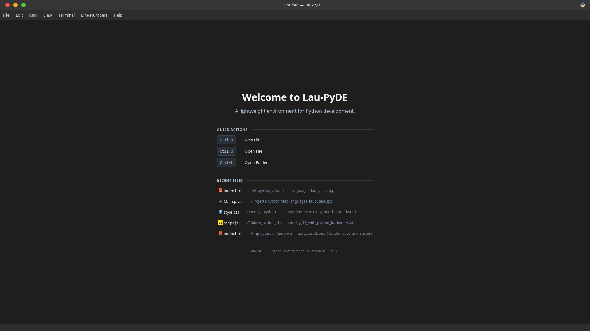

# Lau-PyDE



**Lau-PyDE** is a lightweight Python Development Environment (PyDE) built with **Python + PySide6 + Qt**.

> **Version:** 1.2.0  
> **Platform:** Windows and Linux  
> **Status:** Open Source

Lau-PyDE is designed around one simple workflow:

> **Launch the IDE → Code → Run**

Originally focused on providing a simple Python development environment, Lau-PyDE has evolved into a lightweight multi-language code editor while keeping Python as its primary language and execution environment.

It supports editing multiple file types commonly used in software development without introducing the resource overhead and complexity of a full-scale IDE.

It is intentionally focused on essential development workflows instead of trying to become a PyCharm or VS Code clone.

**Repository:**  
https://github.com/laudotdev/Lau-PyDE_open-source

---

# Features

## Code Editor

### Python Development

- Python syntax highlighting
- Highlighting for keywords, built-ins, functions, classes, numbers, strings, comments, and f-string variables
- Line numbers
- Current-line highlighting
- Real-time syntax and code-issue detection
- Exact-region error highlighting with red wave underlines
- Common Python keyword typo detection with suggestions
- Basic built-in/name typo detection
- Multiple code issues can be detected in the same file
- Automatic indentation after `:`
- Smart indentation backspace
- Open, Save, and Save As
- Unsaved-change protection
- Automatic matching-pair insertion for braces, parentheses, quotes, and apostrophes
- Block commenting with `Ctrl+/`
- `Shift+Tab` removes four spaces from the current or selected lines
- In-editor search with `Ctrl+F`

### Multi-Language Editing

Lau-PyDE v1.2.0 expands beyond Python editing, allowing developers to work with multiple file types inside the same workspace.

**Supported file types:**

| Category | File Extensions |
|---|---|
| Python | `.py` |
| Web Development | `.html`, `.css`, `.js` |
| Markup and Documentation | `.md` |
| Data and Configuration | `.json`, `.yaml`, `.yml`, `.toml` |
| C/C++ | `.c`, `.h`, `.cpp`, `.hpp` |
| Java | `.java` |
| Go | `.go` |
| Rust | `.rs` |

**Features:**

- Language-aware syntax highlighting
- Separate editor tabs for multiple open files
- Lightweight language-specific diagnostics
- Automatic file-type recognition
- External file path support
- Open and save support for supported file types
- Explorer integration for navigating and opening different file types
- Consistent editing experience across supported languages

> **Note:** Multi-language editing does not mean multi-language execution. Lau-PyDE's built-in Run functionality remains Python-only. Other languages can be edited, but their execution requires their respective external development tools.

### HTML, CSS, and JavaScript Assistance

Lau-PyDE also introduces lightweight development assistance for frontend files.

- CSS autocomplete
- JavaScript autocomplete
- Browser-related autocomplete suggestions
- Tab/Enter acceptance for autocomplete suggestions
- HTML abbreviations and snippets
- Automatic HTML structure generation
- Common HTML element abbreviations
- CSS linking through HTML abbreviations
- Input-type abbreviations
- Automatic brace and indentation assistance

**Examples of supported HTML abbreviations:**

| Abbreviation | Purpose |
|---|---|
| `h1` | HTML heading |
| `link:css` | CSS stylesheet link |
| `input:number` | Number input element |
| `!` | Basic HTML document structure |

These features provide lightweight assistance without requiring a full language server or heavyweight development extension system.

### Markdown Support

- Markdown syntax highlighting
- Markdown file editing
- Markdown preview toggle
- Switch between editing and previewing Markdown content

### Multi-File Editing

- Open multiple files simultaneously
- Separate tabs for each opened file
- Switch between files without closing the current workspace
- Tab close controls using SVG icons
- Support for files outside the currently opened project folder
- File opening through the Explorer
- File opening through external paths
- Save changes to their respective original file locations
- Maintain independent editing sessions for opened files

## Project Management

- Open project folders
- Simple file explorer
- Project workspace stays separate from the user's home folder when no project is open
- Remembers the most recently opened project
- Close Project support
- Empty project state when no project is open
- Explorer shows code-issue counts for files with detected problems
- Explorer displays hidden dotfiles such as `.gitignore` and `.env`
- Project root folder name and icon remain visible after restarting Lau-PyDE
- Opened project paths are persisted as absolute paths for Linux and Windows
- Missing or moved saved projects are handled without crashing
- Explorer hierarchy preserves the project root with nested files and folders
- Support for multiple file types within one project
- Synchronization between Explorer, terminal, and active workspace
- Open workspace by dragging a folder from the Dolphin file manager into Lau-PyDE

## Python Runner

- Run the current `.py` file
- Uses the system Python interpreter
- Supports `input()`
- Supports multiple `input()` calls
- Integrated Output panel
- Stop a running Python program
- Displays code issues before execution when diagnostics detect problems
- Running programs use the project workspace as their working directory
- Output run control changes between a Play icon and a Stop icon
- Stop and run controls remain synchronized with the program state
- Built-in execution is exclusively intended for Python files

## Integrated Terminal

- Integrated terminal panel
- Uses the current project workspace as its working directory
- Terminal input
- Current-path prompt
- `lau c` clear command
- Show, minimize, maximize, and restore terminal panel
- Uses the native shell on Linux and Windows
- Supports command history with Up/Down navigation
- Supports persistent `cd` changes within the integrated terminal
- Supports interactive Python REPL input and `input()` prompts
- Supports shell commands such as `echo`, `touch`, `mkdir`, and platform-appropriate removal commands
- Terminal prompts follow the active project folder and avoid stale or duplicate paths
- Terminal output and copied selections remain usable while commands run
- Synchronizes with the active project workspace
- Maintains consistent workspace navigation between the Explorer and terminal

## User Interface

- Dark theme
- Redesigned in-editor welcome screen for the empty/no-project state
- Direct editor-based welcome experience without unnecessary dialog-based navigation
- Explorer panel
- Multi-tab editor panel
- Output panel
- Integrated Terminal panel
- Minimize and maximize controls for panels
- Restore Layout action
- Lau-PyDE application icon and logo
- Recent-project startup behavior
- Commands Palette is synchronized with implemented enabled shortcuts
- Common editing shortcuts work across focused widgets: copy, paste, cut, select all, undo, and redo
- `Ctrl+0` restores the default Explorer, Commands, Output, and Terminal layout
- Output, Terminal, and Explorer controls use one shared SVG icon set
- Panel controls keep consistent sizing, padding, spacing, and alignment on Linux and Windows
- Output orientation can move between bottom and right layouts
- Persistent Show Key Shortcuts option
- Shared custom file icons for supported file types
- Dedicated SVG icons for `.gitignore` and `.env` files
- Consistent editor tab appearance and SVG-based tab close controls
- Improved workspace navigation and synchronization
- Markdown preview toggle
- Dolphin drag-and-drop folder integration

## v1.2.0 Release Validation

Run the automated checks before preparing release assets:

```sh
python3 -m pytest -q
python3 -m compileall -q core ui main.py launcher.py
```

On Arch Linux, build the package with:

```sh
./installer/arch/build-arch-package.sh
```

Confirm the resulting file exists under `installer/arch/` before publishing it.

For generic Linux, run:

```sh
./installer/linux/install.sh
```

Uninstall with:

```sh
./installer/linux/uninstall.sh
```

These scripts use a user-level installation and do not replace user projects or settings.

The Windows installer must be built and tested on Windows using the workflow in `installer/windows/README.md`.

GitHub Releases remains the source of release metadata. The website source is not part of this repository, so website deployment and platform-specific website links require separate verification.

## Installation & Packaging

- Installable as a Python application package
- `pyde` command available after installation
- Lau-PyDE launcher command:

```text
pyde lau
```

- Supports standalone Windows installer distribution
- Supports Linux installation through the provided installation scripts and distribution-specific packaging
- Designed around the packaging philosophy:

```text
Install once → Run everywhere
```

Once installed, `pyde lau` can be launched from the repository directory or another working directory.

### Update Availability

Source-based package installations can receive updates earlier than separately built standalone installers and Linux distribution packages.

Users who install directly from the GitHub repository can access newer repository changes as soon as those changes are available and installable. Standalone Windows `.exe` installers and Linux installation packages follow their respective build, testing, and release processes, so their updates may become available later.

For users who prioritize earlier access to development updates, the source-based installation is the preferred option. Standalone installers remain the more convenient option for users who prefer a packaged installation experience.

---

# PyCharm vs. Lau-PyDE

Lau-PyDE was created with a strong focus on being lightweight on a modest laptop. One of the project's early goals was to compare the actual resource usage of the two applications on the same machine.

## Recorded Benchmark

The following results were recorded on the same **Arch Linux** system while testing the same large project.

| Metric | PyCharm | Lau-PyDE |
|---|---:|---:|
| Startup time | **25.52 s** | **4.72 s** |
| Process RSS | **~1.24–1.27 GiB** | **~121–122 MiB** |
| Approx. RAM difference | — | **~90.5% less RSS than PyCharm** |

The process measurement was taken using:

```bash
ps -eo pid,ppid,%mem,rss,cmd --sort=-rss | head -20
```

The recorded process RSS values were approximately:

- **PyCharm:** 1,264–1,272 MiB
- **Lau-PyDE:** 121–122 MiB

These are **recorded measurements from one test environment**, not a universal benchmark for every computer, project, or PyCharm version. System background processes, caches, project size, and configuration can affect memory usage.

The benchmark reflects the project's main design goal: **keep the development environment simple and lightweight while providing the essential tools needed for everyday development.**

> The figures above represent the earlier recorded benchmark, not a controlled v1.2.0 performance comparison.

---

# Installation

Lau-PyDE v1.2.0 is distributed through its source repository and platform-specific installation methods.

The recommended installation method is the standalone `.exe` installer for Windows and **pipx** for Linux source-based installations.

pipx installs the application into an isolated environment and exposes its command on your `PATH`. This also keeps Lau-PyDE's dependencies separate from the operating system's Python environment.

For users who prioritize receiving development updates earlier, installing directly from the GitHub repository is recommended.

## Requirements

- Python **3.10+**
- Git, if cloning the repository
- pipx for source-based Linux installation
- A desktop environment capable of running PySide6 applications

> The current pipx installation requires Python 3.10 or newer on the machine used to install pipx.

## Windows

### Windows Installer

> **Note:** `Lau-PyDE_setup_v1.2.0.exe` is not available. Install v1.2.0 from the source repository using the steps below.

> **Compatibility:** Lau-PyDE is primarily developed and tested on Linux-based distributions, where it has the strongest compatibility. Windows is also supported, but some behavior may differ by system.

#### Install Lau-PyDE v1.2.0

1. Install Python 3.10 or newer from [python.org](https://www.python.org/downloads/windows/). In the installer, enable **Add python.exe to PATH**.
2. Install [Git for Windows](https://git-scm.com/download/win).
3. Open PowerShell and confirm Python is available:

   ```powershell
   py --version
   ```

4. Install Lau-PyDE from the project repository:

   ```powershell
   py -m pip install --upgrade pip
   py -m pip install git+https://github.com/laudotdev/Lau-PyDE_open-source.git
   ```

5. Start the application:

   ```powershell
   pyde lau
   ```

If PowerShell says `pyde` is not recognized, close and reopen PowerShell so the Python Scripts directory is added to the session PATH.

For the previous version, download **Lau-PyDE-Setup.exe** from [laupyde.online](https://laupyde.online).

---

## Linux

### Arch Linux

Install pipx through `pacman`:

```bash
sudo pacman -S python-pipx
```

Then:

```bash
pipx ensurepath
```

Restart the terminal, then verify:

```bash
pipx --version
```

Clone and install Lau-PyDE:

```bash
git clone https://github.com/laudotdev/Lau-PyDE_open-source.git
cd Lau-PyDE_open-source
pipx install .
```

Run:

```bash
pyde lau
```

### Ubuntu / Debian

On recent Ubuntu and Debian releases that use an externally managed system Python, install pipx through the distribution package manager instead of installing it into the system Python with pip.

**Ubuntu:**

```bash
sudo apt update
sudo apt install pipx
pipx ensurepath
```

**Debian:**

```bash
sudo apt update
sudo apt install pipx
pipx ensurepath
```

Then install Lau-PyDE:

```bash
git clone https://github.com/laudotdev/Lau-PyDE_open-source.git
cd Lau-PyDE_open-source
pipx install .
```

Run:

```bash
pyde lau
```

### Fedora

```bash
sudo dnf install pipx
pipx ensurepath
```

Then:

```bash
git clone https://github.com/laudotdev/Lau-PyDE_open-source.git
cd Lau-PyDE_open-source
pipx install .
```

Run:

```bash
pyde lau
```

### Other Linux Distributions

Use the distribution's package manager to install `pipx` when available. This avoids conflicts with distributions that mark the system Python as externally managed.

Once `pipx` is installed:

```bash
pipx ensurepath
git clone https://github.com/laudotdev/Lau-PyDE_open-source.git
cd Lau-PyDE_open-source
pipx install .
```

Then run:

```bash
pyde lau
```

### Install the Full App with the Linux Shell Installer

This is an alternative to the pipx steps above. It installs the full app under your home directory using `installer/linux/install.sh`. It also works on Arch Linux; the native Arch package instructions remain a separate installation option.

1. Install Git and Python 3.10 or newer with virtual-environment support using your distro's package manager. For example:

   **Arch Linux:**

   ```bash
   sudo pacman -S --needed git python
   ```

   **Ubuntu or Debian:**

   ```bash
   sudo apt update
   sudo apt install git python3 python3-venv
   ```

   **Fedora:**

   ```bash
   sudo dnf install git python3
   ```

2. Clone the Lau-PyDE repository and enter its folder:

   ```bash
   git clone https://github.com/laudotdev/Lau-PyDE_open-source.git
   cd Lau-PyDE_open-source
   ```

3. Run the Linux installer from the repository root:

   ```bash
   ./installer/linux/install.sh
   ```

4. Ensure `~/.local/bin` is on your `PATH`. Open a new terminal if you just added it.
5. Launch Lau-PyDE:

   ```bash
   lau-pyde
   ```

The shell installer creates a virtual environment and installs the app, launcher, desktop entry, and icon under your home directory. To remove this user-local installation, run `./installer/linux/uninstall.sh` from the cloned repository.

### Install Directly from Git

For a pipx-supported source-control installation, you can also install directly from the repository:

```bash
pipx install git+https://github.com/laudotdev/Lau-PyDE_open-source.git
```

Then:

```bash
pyde lau
```

pipx supports installing applications from local paths and Git repositories.

---

# Install Once → Run Everywhere

The packaging goal is simple:

```text
Install once → Run everywhere
```

After installation, the launcher is:

```bash
pyde lau
```

For example:

```bash
cd ~/Projects
pyde lau
```

or:

```bash
cd /tmp
pyde lau
```

The application should not require the repository directory to be the current working directory.

Source-based installations can receive repository updates earlier than separately packaged standalone releases.

---

# First Launch

1. Start Lau-PyDE with `pyde lau`.
2. If no recent project exists, Lau-PyDE opens its welcome/empty state.
3. Open a project folder using **Open Folder**.
4. Alternatively, drag a folder from Dolphin into Lau-PyDE to open it as a workspace.
5. The selected folder becomes the workspace.
6. Open a supported file from the Explorer.
7. Write or edit code using the editor.
8. Switch between opened files using their respective editor tabs.
9. Lau-PyDE provides language-aware syntax highlighting and supported diagnostics while you work.
10. Use the Markdown preview when working with Markdown documents.
11. Run the current Python file when working with Python.
12. View execution results in the Output panel.
13. Programs using `input()` receive input through the integrated input area.
14. The terminal uses the current project folder as its working directory.
15. Use **Close Project** to unload the workspace and return to the welcome state.

Lau-PyDE remembers the most recently opened project folder and attempts to restore it on the next launch.

## Example

```python
name = input("Enter your name: ")
print(f"Hello, {name}!")
```

**Expected output:**

```text
Enter your name: Laurence
Hello, Laurence!
```

---

# Project Structure

```text
Lau-PyDE/
├── assets/
│   └── logo.png
├── core/
│   ├── file_manager.py
│   └── runner.py
├── ui/
│   ├── editor.py
│   ├── explorer.py
│   ├── inline_output.py
│   ├── main_window.py
│   └── terminal.py
├── launcher.py
├── main.py
├── pyproject.toml
├── requirements.txt
├── README.md
├── RELEASE_NOTES.md
```

---

# Design Philosophy

Lau-PyDE focuses on providing a lightweight development environment without unnecessary complexity.

Its development workflow can be summarized as:

```text
Write → Check → Run → Output → Fix → Run again
```

Although v1.2.0 expands its editing capabilities to multiple programming and markup languages, Python remains the primary focus of the project.

The goal is not to replace heavyweight IDEs or compete with every feature they offer. Instead, Lau-PyDE provides a practical environment for developers who need a fast, straightforward editor with essential development tools.

The project prioritizes:

- Simple startup
- Low memory usage
- A clean interface
- Lightweight multi-language editing
- Essential Python development tools
- Learning through building
- Minimal unnecessary features
- Cross-platform consistency
- User control over the development environment

---

# Version Scope

## V1.0.0 – V1.1.0

The initial development stages focused on establishing and improving the core Python development environment.

Major development priorities included:

- Python code editing
- Python execution
- Integrated terminal
- Project management
- Code diagnostics
- Editor usability
- Cross-platform reliability
- Installation and packaging
- Resource efficiency

Much of the early work involved fixing existing flaws, improving diagnostics, cleaning up the user experience, and making the application easier to install and run.

## V1.2.0 – Multi-Language Editing

Version 1.2.0 expands Lau-PyDE beyond its original Python-only editing experience.

The motivation came from practical development workflows where working on a single application often requires switching between different languages and file types.

For example, developing a Flask application involves working with Python backend files alongside HTML, CSS, and JavaScript frontend files.

Previously, this required switching between different editors to handle the frontend and backend portions of a project.

With v1.2.0, Lau-PyDE introduces multi-file and multi-language editing capabilities, allowing developers to work with these files inside one lightweight environment.

**Major additions include:**

- Multi-language syntax highlighting
- Multiple editor tabs
- HTML, CSS, JavaScript, Markdown, JSON, YAML, TOML, C/C++, Java, Go, and Rust editing support
- Lightweight language diagnostics
- CSS and JavaScript autocomplete
- HTML abbreviations and snippets
- Markdown preview
- Shared file icons
- Improved workspace synchronization
- Dolphin drag-and-drop folder integration
- Persistent keyboard shortcut visibility
- Redesigned in-editor welcome experience
- HTML, CSS, JS improved syntax coloring (for var, functions, built-ins, name call and etc.)
- Auto language comment detection e.g. highlight block then Ctrl + / for js now `// commented block`

The expansion does not change the project's core identity:

> **Lau-PyDE remains a Python Development Environment with additional multi-language editing capabilities.**

## Not in Scope `Impossible features`

The following features remain outside the current project scope:

- AI assistant
- Built-in debugger
- Git integration
- Language server integration
- Full advanced autocomplete
- Plugin system
- Project indexing
- Cloud services
- Telemetry
- Built-in execution for programming languages other than Python

These exclusions help keep the project focused on performance, simplicity, and maintainability.

---

# Recent Fixes and Improvements

Recent development updates focused on reliability, consistency, and expanding the editor's capabilities across Linux and Windows.

### Editor and Language Support

- Expanded the editor to support multiple programming languages and file types.
- Added separate tabs for multiple opened files.
- Introduced language-aware syntax highlighting.
- Added lightweight diagnostics for supported languages.
- Added CSS and JavaScript autocomplete.
- Added HTML abbreviations and snippets.
- Added Markdown preview functionality.
- Improved external-file handling and file path support.
- Added shared custom file icons for supported file types.
- Improved tab appearance and introduced SVG-based tab close controls.

### Workspace and Navigation

- Added folder drag-and-drop integration with the Dolphin file manager.
- Improved synchronization between the Explorer, terminal, and recent workspace.
- Improved workspace navigation and project restoration.
- Maintained project root visibility and Explorer hierarchy.
- Improved handling of missing or moved saved projects.

### User Interface

- Redesigned the welcome experience to provide a more direct editor-based interface.
- Added persistent Show Key Shortcuts functionality.
- Improved panel consistency through shared SVG icons.
- Standardized panel control alignment and sizing.
- Improved the overall editing experience across Linux and Windows.

### Previous Reliability Improvements

- Fixed recent-project startup ordering so the restored folder is applied after terminal initialization.
- Fixed terminal prompt duplication, stale home-directory prompts, missing command output, and extra blank lines.
- Fixed interactive Python input so the REPL banner, prompts, submitted commands, output, and `input()` responses remain separated correctly.
- Fixed terminal output selection and Ctrl+C copying without losing the highlighted block.
- Added persistent terminal working-directory behavior for `cd`.
- Fixed selected-code `Shift+Tab` handling so focus does not move to unrelated controls.
- Fixed Commands Palette accuracy so unavailable or unregistered shortcuts are not advertised.
- Added cross-platform focused-widget editing shortcut handling.
- Fixed Explorer root restoration and stale saved-folder handling.
- Added complete default-layout restoration through `Ctrl+0`.
- Replaced mixed Unicode panel glyphs with shared vector icons and standardized panel control alignment.
- Kept local tests, IDE metadata, virtual environments, caches, and build artifacts out of Git tracking through `.gitignore`.

---

# Known Limitations

- Multi-language editing does not provide built-in execution for languages other than Python.
- No built-in debugger.
- No Git integration.
- No full language server integration.
- No advanced language-server-based autocomplete.
- Syntax checking and diagnostics are intentionally lightweight.
- Built-in typo detection is heuristic and can never replace a full language server.
- CSS and JavaScript autocomplete provide lightweight assistance rather than a complete IDE-level language intelligence system.
- The integrated terminal is not a full native terminal emulator.
- Some advanced ANSI terminal behavior may not be reproduced exactly.
- Resource usage and startup time can vary depending on the system, opened files, and project being used.
- Standalone installer updates may become available later than source-based package updates.

---

# Development

Built with:

- Python
- PySide6
- Qt
- `pathlib`
- `ast`
- `difflib`
- `QProcess`

The project is developed as an open-source project and is intentionally kept simple enough to be understandable and modifiable.

## Running from Source

For development, you can still run the application directly from the repository:

```bash
python main.py
```

For the packaged application workflow, use:

```bash
pyde lau
```

---

# Open Source

Lau-PyDE is an open-source project.

**Repository:**  
https://github.com/laudotdev/Lau-PyDE_open-source

Issues, fixes, improvements, and future development are tracked through the project repository.

## License

This project is open source. See the repository for license information.

## Credits

Built by **John Laurence Aramay / laudotdev**.
