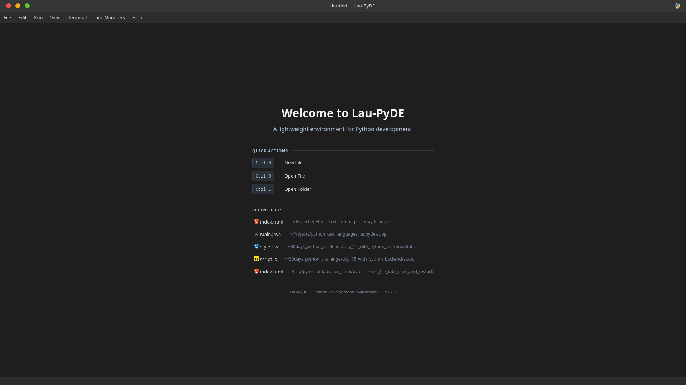

# Lau-PyDE v1.2.0



**Release date:** November 22, 2026

Lau-PyDE v1.2.0 expands the editor beyond Python while keeping Python as its primary language and execution environment. This release adds multi-language editing, language-aware editing tools, and updated Linux installation options.

## What's New

- **Multi-language editing:** Work with HTML, CSS, JavaScript, Markdown, JSON, YAML, TOML, C, C++, Java, Go, and Rust files in the same workspace.
- **Multiple editor tabs:** Keep several files open and switch between them in one window.
- **Language-aware syntax colors:** Expanded JavaScript highlighting for keywords, declared variables, functions, built-ins, members, properties, and operators. HTML highlighting distinguishes tags, attributes, values, entities, and comments, including comments that span lines.
- **Comment toggling:** Use `Ctrl+/` to comment or uncomment selected lines with the active language's syntax, such as `//` for JavaScript and `#` for Python.
- **Editing assistance:** CSS and JavaScript completions, HTML abbreviations and snippets, lightweight diagnostics, and Markdown preview.
- **Workspace improvements:** Shared file icons, improved workspace synchronization, Dolphin folder drag-and-drop, a redesigned welcome screen, and a persistent Key Shortcuts visibility preference.

Lau-PyDE's built-in Run action remains for Python. Editing another language does not provide a built-in runtime for it.

## Fixes and Improvements

- Kept the Key Shortcuts panel hidden after closing one project and opening another when the user's saved preference is to hide it. The View menu check state now follows the saved setting.
- Applied HTML comment coloring across line breaks so markup-looking text inside a comment is not highlighted as live HTML.
- Made the Linux desktop launcher use an absolute path, so launching from the application menu does not depend on the desktop session's `PATH` containing `~/.local/bin`.
- Added visible progress stages to the generic Linux installer and Arch package build. Pip output is no longer hidden during installation.
- Corrected the Arch package recipe to use the current `pyside6` dependency and Linux installer asset paths. The source archive no longer recursively includes previous build outputs.

## Installation

Lau-PyDE is primarily developed and tested on Linux-based distributions. Windows is supported through source installation, but behavior may vary by system.

### Generic Linux Installation

The full user-local shell installer works on Arch Linux and other Linux distributions. Start from a repository checkout and run:

```sh
./installer/linux/install.sh
```

The installer creates a virtual environment under `~/.local/share/lau-pyde` and installs the launcher, desktop entry, and icon under the user's local directories. Ensure `~/.local/bin` is on `PATH`, then launch with:

```sh
lau-pyde
```

The complete steps and distro-specific prerequisites are in [installer/README.md](installer/README.md#generic-linux-installation).

### Arch Linux Package

A native Arch package is available as `installer/arch/lau-pyde-1.2.0-1-any.pkg.tar.zst`. Install it with:

```sh
sudo pacman -U installer/arch/lau-pyde-1.2.0-1-any.pkg.tar.zst
```

The package requires `python` and `pyside6`. To build it from source, follow [the Arch Linux instructions](installer/README.md#arch-linux).

### Windows

The `Lau-PyDE_setup_v1.2.0.exe` installer is **not available** for this release. Windows users can install v1.2.0 from the source repository using Python and Git; see the [Windows installation steps in the README](README.md#windows-installer). The previous Windows installer is linked from [laupyde.online](https://laupyde.online).

## Notes

- The native `.pkg.tar.zst` package is for Arch Linux. Other Linux distributions can use the user-local shell installer or the documented pipx installation.
- `installer/linux/install.sh` must be run from a cloned or downloaded source checkout; it is not a standalone downloadable installer script.
- Publishing or deploying website downloads is separate from changes in this repository.
- Multi-language support is focused on editing and lightweight assistance; it does not include language servers, advanced autocomplete, or built-in execution for non-Python languages.
